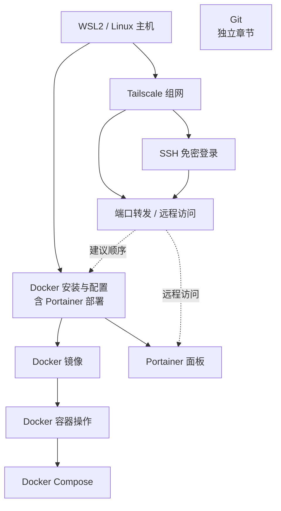

# 现代开发工具手册

现代开发中常用工具的使用教程与速查。

## 目录

- [Git](docs/git.md) — 版本控制、分支、远程协作
- [Docker 安装与配置](docs/docker_install.md) — 安装、配置、图形面板
- [Docker 镜像](docs/docker_images.md) — 拉取、打标签、删除、构建镜像
- [Docker 容器操作](docs/docker_containers.md) — 创建、起停、查看状态、进入容器
- [Docker Compose](docs/docker_compose.md) — YAML 编排多容器、常用命令
- [SSH](docs/ssh.md) — Tailscale 组网、密钥、免密登录、端口转发
- [WSL2](docs/wsl2.md) — 安装、常用操作、资源与网络配置、磁盘迁移、卸载

## 配置顺序与依赖

- **WSL2 / Linux 主机**：唯一前置，已有 Linux 服务器时无需 WSL2
- **Tailscale 组网 → SSH 免密登录**：SSH 多数场景经 Tailscale 访问，先组网再配置密钥；两者都可作为远程访问通路
- **Docker 安装与配置 → 镜像 → 容器 → Compose**：先有镜像才能创建容器；多容器或固定配置的场景用 Compose 编排
- **Docker 安装与配置**：只依赖主机；本手册建议先打通远程访问，再部署容器和 Portainer
- **Portainer 远程访问**：复用上一步的端口转发（SSH 隧道）或 Tailscale 直连
- **Git**：独立章节，不参与上述依赖

## 说明

本手册记录常用开发工具的安装、配置与日常操作，具体问题可结合 AI 工具排查。
